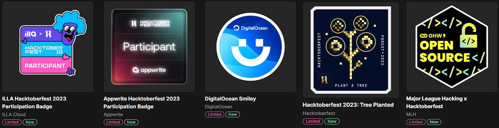
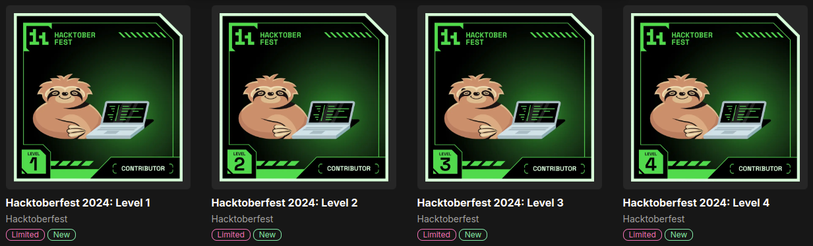

  

  

  

#  About Me

I am a Software Engineer building distributed backends, mobile and web products, and AI-powered workflows. When I'm not coding, you can find me exploring the latest tech trends or enjoying movies and video games. Let's connect and build something amazing together!

 

#  Socials

Connect with me on:  

 

#  Tech Stack

###  Languages

     

###  Frontend & Mobile

        

###  Backend

     

###  Databases & ORMs

         

###  Messaging & Jobs

    

###  Cloud & DevOps

   

###  AI

  

###  Tools

    

 

#  Certifications

 

#  Open Source Contributions

###  Hacktoberfest 2023

###  Hacktoberfest 2024

 

#  GitHub Stats

  
  

  
  

<!-- Proudly created with GPRM ( https://gprm.itsvg.in ) -->
